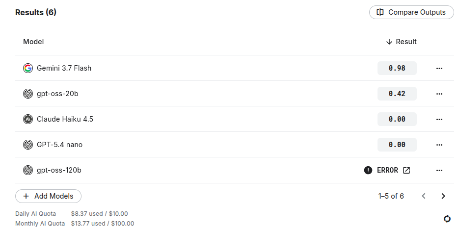

# Tennis & Padel State Tracking Benchmark

Can LLMs keep score? Given a point-by-point tennis or padel sequence, the model reports sets, games, points and who serves next. Answers are checked by exact match against a rules engine written in Python, with and without the rules in the prompt.

> **Built for the [DEV x Kaggle Benchmarking Challenge](https://dev.to/challenges/kaggle-2026-09-23).** This project was created for the challenge, which asks participants to build a benchmark on Kaggle, run it against real models, and write about what they found. Read the write-up on DEV: <https://dev.to/gulrez/can-llms-keep-score-i-benchmarked-tennis-and-padel-score-tracking-7ol>

**Live benchmark on Kaggle:** https://www.kaggle.com/benchmarks/gulrezqayyum/tennis-and-padel-state-tracking-benchmark

## Results (48 cases, one run per case, default settings)

| Model | Accuracy |
|---|---|
| Gemini 3.7 Flash | 0.96 |
| gpt-oss-20b | 0.42 |
| Claude Haiku 4.5 | 0.00 |
| GPT-5.4 nano | 0.00 |
| Gemma 4 26B A4B | error |

## What's in the benchmark
- Tennis (advantage scoring) and padel (golden point)
- Sequences of 30, 60 and 100 points, plus forced 6-6 tiebreak cases
- Each point sequence asked with the rules written out and without

## Files
- `tennis_padel_benchmark.py`: scoring engine, case generator and the Kaggle task

## Limits
Small sample (48 cases), one run per case, and a few models only. In my tests the same model sometimes gave different answers to the same prompt, so single-run differences between conditions should be treated carefully.

